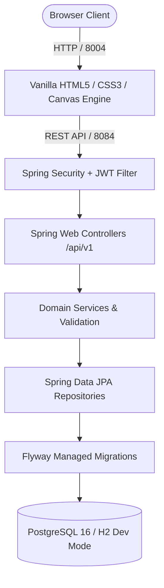

# Dial & Form — Premium Watch Storefront

[](https://openjdk.org/projects/jdk/21/)
[](https://spring.io/projects/spring-boot)
[](https://www.postgresql.org/)
[](https://flywaydb.org/)
[](http://localhost:8080/swagger-ui.html)
[](LICENSE)

An independent, Rolex-focused storefront for browsing watch models, viewing detailed specifications, saving favorites, and managing a shopping bag. Built around a **cinematic scroll-driven HTML5 canvas animation** (240 WebP frame sequence with predictive caching), with a **Java 21 / Spring Boot 3.3 REST API**, automated **Flyway** schema migrations, stateless **JWT authentication**, and persistent user wishlists. Dial & Form is not represented as a Rolex-authorized retailer.

---

## Architecture Overview



---

## Key Features

1. **Cinematic Scroll Animation**:
   - 240 pre-rendered WebP frames loaded on demand into an HTML5 Canvas 2D context (`alpha: false, desynchronized: true`).
   - Predictive LRU frame cache (`AHEAD = 10`, `BEHIND = 3`, capped DPR at 1.75) ensuring smooth reverse-scroll reassembly without white flashes.
   - Built-in `prefers-reduced-motion` compliance.

2. **Rolex-Focused Watch Storefront**:
   - Debounced real-time search across model names, brands, and calibers.
   - Dedicated collection, brand, watch detail, account, cart, checkout, order, and admin routes.
   - Multi-criteria filtering by brand, category, movement type, case material, and price range.
   - Responsive editorial pages styled in a refined palette (`#071b16`, `#f3f0e8`, `#c9a66c`).

3. **Technical Dossier & Specifications**:
   - In-depth horological specifications: Caliber, movement type, case diameter/thickness, water resistance depth rating, power reserve hours, dial color, and complications.

4. **Shopping, Authentication & Wishlists**:
   - Stateless JWT authentication (`/api/v1/auth/login`, `/api/v1/auth/register`, `/api/v1/users/me`).
   - Passwords securely hashed with BCrypt.
   - Database-backed user wishlists (`/api/v1/me/wishlist`) synced automatically across sessions.
   - Cart and checkout validation require configured prices and stock; unpriced catalog items remain unavailable for purchase.

5. **Backend Engineering**:
   - Spring Boot Actuator health and metrics endpoints (`/actuator/health`).
   - Interactive Swagger UI documentation (`/swagger-ui.html`).
   - Dual-profile configuration (`dev` with in-memory H2, `prod` with containerized PostgreSQL).

---

## Technology Stack

- **Storefront**: Semantic HTML5, custom responsive CSS, modern JavaScript, and Canvas 2D for the 240-frame scroll animation.
- **Local web server**: Python 3 `ThreadingHTTPServer` serves the frontend and proxies `/api/v1` requests during development. This is a development server, not a production host.
- **Backend API**: Java 21, Spring Boot 3.3.4, Spring Web, Spring Data JPA, Spring Security, Bean Validation, and Actuator.
- **Authentication**: Supabase Auth email/password sessions, verified server-side against Supabase Auth before mapping the stable provider ID to the existing local user row. Existing local JWT/password endpoints remain available during setup and account transition.
- **Data**: PostgreSQL 16 for containerized deployments; H2 in-memory database for local development; Flyway for schema and catalog migrations.
- **Store functions**: Catalog, product specifications, account registration/sign-in, wishlist, cart, shipping addresses, orders, and shipment status records.
- **Payment status**: Development-only simulated payment flow. It does not contact Razorpay or process funds; live gateway credentials and integration are not configured.
- **Catalog media**: Original 240 WebP animation frames plus local catalog image mapping. Brochure-derived product images remain in the ignored private review folder until redistribution rights are cleared.
- **API documentation**: springdoc-openapi (`/v3/api-docs` and Swagger UI).
- **Build and delivery**: Maven Wrapper, Docker Compose, and GitHub Actions CI. No public hosting target is configured.

### Configuration still required for a live store

- Supabase project URL and publishable key, email confirmation settings, and allowed redirect URLs. Never configure a service-role key in the browser.
- Verified selling prices, inventory quantities, currency, taxes, shipping rates, and return policy.
- A selected payment gateway with sandbox credentials and a verified webhook flow.
- Cleared product-image rights and a production hosting/domain configuration.

Until those items are configured, unpriced products cannot be purchased and the payment workflow remains clearly marked as a local demo.

---

## REST API Specification

| Method | Endpoint | Access | Description |
| :--- | :--- | :--- | :--- |
| `GET` | `/api/v1/watches` | Public | Paginated, searchable, filtered watch catalog |
| `GET` | `/api/v1/watches/{slug}` | Public | Detailed specifications of a watch by unique slug |
| `GET` | `/api/v1/watches/featured` | Public | Curated spotlight timepieces |
| `GET` | `/api/v1/watches/brands` | Public | Distinct list of brands in the catalog |
| `GET` | `/api/v1/categories` | Public | All horological categories |
| `POST`| `/api/v1/auth/login` | Public | Authenticate user and receive JWT bearer token |
| `POST`| `/api/v1/auth/register` | Public | Register a new collector account |
| `GET` | `/api/v1/users/me` | User | Get current authenticated user profile |
| `GET` | `/api/v1/me/wishlist` | User | Get authenticated user's saved wishlist |
| `PUT` | `/api/v1/me/wishlist/{id}` | User | Add timepiece to wishlist |
| `DELETE`| `/api/v1/me/wishlist/{id}` | User | Remove timepiece from wishlist |
| `POST`| `/api/v1/admin/watches` | Admin | Create a new watch entry |
| `PATCH`| `/api/v1/admin/watches/{id}`| Admin | Update an existing watch |
| `DELETE`| `/api/v1/admin/watches/{id}`| Admin | Archive a watch entry |
| `GET` | `/actuator/health` | Public | Application and database health status |

---

## Getting Started

### Prerequisites

- **Java 21 LTS** (`java -version`)
- **Python 3** (for serving the static frontend locally)
- *(Optional)* **Docker & Docker Compose** (for PostgreSQL production mode)

### 1. Run Backend Locally (Zero-Configuration Dev Mode)

The backend includes a `dev` profile using an in-memory database with PostgreSQL compatibility and Flyway seeding:

```bash
cd backend
SERVER_PORT=8084 ./mvnw spring-boot:run
```

- Swagger UI: `http://localhost:8084/swagger-ui.html`
- Health Check: `http://localhost:8084/actuator/health`

### 2. Run Frontend Locally

From the root directory (the server falls back to `index.html` for direct navigation to storefront routes):

```bash
python3 server.py --port 8004 --backend-port 8084
```

Open `http://localhost:8004` in your web browser. The Python server serves the frontend and proxies API requests to the backend port above.

### 3. Connect Supabase Auth

The same public project URL and publishable key are needed by both the backend and the local preview server. Set `SUPABASE_URL` and `SUPABASE_PUBLISHABLE_KEY` in each process environment before starting it. The browser SDK is loaded only when both values are present. In Supabase Authentication settings, enable Email/password, keep email confirmation enabled, set the local Site URL to `http://localhost:8004`, and add `http://localhost:8004/**` to the allowed redirect URLs. Add your eventual production domain there later. V6 adds a nullable unique Supabase identity column; it preserves existing user IDs and their related orders, carts, and wishlists. Flyway applies it automatically at backend startup, so review and back up any persistent database before production rollout.

When someone signs in with a confirmed email already present in the local user table, the backend links the Supabase ID to that same row. New Supabase accounts get a standard customer row. Passwords remain managed by Supabase; local commerce data continues to use the current backend and database.

### 4. Demo Credentials

- **Development seed account**: `collector@atelierwatch.dev` / `Admin@123456` (local development only; change before using any shared environment)

---

## Production Deployment with Docker Compose

To deploy both PostgreSQL and the Spring Boot backend in containers:

```bash
cp .env.example .env
# Set SPRING_DATASOURCE_PASSWORD and generate JWT_SECRET with: openssl rand -base64 32
docker compose up -d --build
```

## Render Staging

The repository includes a Render Blueprint at [`render.yaml`](render.yaml). It creates a public storefront, a Spring API, and a new private-network-only PostgreSQL database in Singapore. The API applies Flyway migrations only to that newly created staging database. Brochure candidate images and the local `.env.local` file are excluded; until image rights are cleared, products use the public placeholder image.

To create the staging services, open [Deploy this repository to Render](https://render.com/deploy?repo=https://github.com/Yashr4635/Dial-and-Form), connect the `Yashr4635/Dial-and-Form` GitHub repository, and enter the Supabase project URL and **publishable** key when Render asks. Never enter a Supabase service-role/secret key or a Resend API key into frontend configuration. The backend JWT secret is generated by Render.

Render is configured to deploy the `main` branch only after the GitHub Actions checks pass. To publish a code change, commit it and push it to `main`; an unsaved local edit does not update the hosted site. Render Free web services can sleep when idle, and a Free Postgres database expires after 30 days, has no backups, and is for temporary staging only. Upgrade or replace the staging database before relying on it for persistent user or commerce data. This setup is not a production commerce deployment.

---

## Portfolio & Interview Highlights

- **Predictive Canvas Animation Engine**: Engineered a frame scheduler mapping vertical scroll progress to 240 WebP assets using a directional lookahead LRU cache, preventing UI jank and maintaining 60 FPS performance without memory leaks.
- **Decoupled Architecture**: Preserved high-performance static asset delivery while introducing an enterprise Java 21 REST backend with Spring Security and stateless JWT authentication.
- **Relational Data Integrity**: Designed normalized PostgreSQL schemas with Flyway migrations, enforcing decimal precision for currency and composite uniqueness constraints on wishlist items.
- **Comprehensive Test Coverage**: Implemented end-to-end integration tests using MockMvc and JUnit 5 validating security boundaries, query filtering, and OpenAPI contracts.
