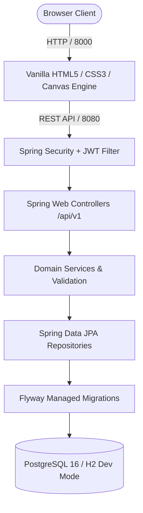

# Atelier Watch — Full-Stack Horology Discovery & Comparison Platform

[](https://openjdk.org/projects/jdk/21/)
[](https://spring.io/projects/spring-boot)
[](https://www.postgresql.org/)
[](https://flywaydb.org/)
[](http://localhost:8080/swagger-ui.html)
[](LICENSE)

An independent, portfolio-grade luxury watch discovery and technical comparison platform. Built around a **cinematic scroll-driven HTML5 canvas animation** (240 WebP frame sequence with predictive caching), integrated seamlessly with an enterprise **Java 21 / Spring Boot 3.3 REST API**, automated **Flyway** schema migrations, stateless **JWT authentication**, and persistent user wishlists.

---

## Architecture Overview



---

## Key Features

1. **Cinematic Scroll Animation**:
   - 240 pre-rendered WebP frames loaded on demand into an HTML5 Canvas 2D context (`alpha: false, desynchronized: true`).
   - Predictive LRU frame cache (`AHEAD = 10`, `BEHIND = 3`, capped DPR at 1.75) ensuring smooth reverse-scroll reassembly without white flashes.
   - Built-in `prefers-reduced-motion` compliance.

2. **Luxury Watch Discovery Catalog**:
   - Debounced real-time search across model names, brands, and calibers.
   - Dynamic category pills fetched directly from `/api/v1/categories`.
   - Multi-criteria filtering by movement type, case material, and price range.
   - Responsive modal overlay styled to match the dark luxury palette (`#071b16`, `#f3f0e8`, `#c9a66c`).

3. **Technical Dossier & Specifications**:
   - In-depth horological specifications: Caliber, movement type, case diameter/thickness, water resistance depth rating, power reserve hours, dial color, and complications.

4. **Side-by-Side Comparison Matrix**:
   - Multi-watch comparison tray allowing users to inspect 2 to 4 timepieces simultaneously.
   - Direct comparison of case dimensions, power reserves, water resistance, and prices.

5. **Authentication & Persistent Wishlists**:
   - Stateless JWT authentication (`/api/v1/auth/login`, `/api/v1/auth/register`, `/api/v1/users/me`).
   - Passwords securely hashed with BCrypt.
   - Database-backed user wishlists (`/api/v1/me/wishlist`) synced automatically across sessions.

6. **Enterprise Backend Engineering**:
   - Spring Boot Actuator health and metrics endpoints (`/actuator/health`).
   - Interactive Swagger UI documentation (`/swagger-ui.html`).
   - Dual-profile configuration (`dev` with in-memory H2, `prod` with containerized PostgreSQL).

---

## Technology Stack

- **Frontend**: HTML5, Vanilla CSS3 (Custom Design System & Tokens), Modern ES6+ JavaScript, Canvas 2D API.
- **Backend**: Java 21 LTS, Spring Boot 3.3.4, Spring Web, Spring Data JPA, Spring Security, Bean Validation, Spring Boot Actuator.
- **Database & Migrations**: PostgreSQL 16, H2 Database (Dev), Flyway.
- **Security**: JWT (`io.jsonwebtoken:jjwt`), BCrypt Password Encoding, CORS filtering.
- **Documentation**: springdoc-openapi (`v3/api-docs` & Swagger UI).
- **Testing**: JUnit 5, MockMvc, Mockito.
- **DevOps & Containers**: Docker, Docker Compose, Maven Wrapper (`./mvnw`), GitHub Actions CI.

---

## REST API Specification

| Method | Endpoint | Access | Description |
| :--- | :--- | :--- | :--- |
| `GET` | `/api/v1/watches` | Public | Paginated, searchable, filtered watch catalog |
| `GET` | `/api/v1/watches/{slug}` | Public | Detailed specifications of a watch by unique slug |
| `GET` | `/api/v1/watches/compare?ids=1,2` | Public | Side-by-side comparison matrix (up to 4 watches) |
| `GET` | `/api/v1/watches/featured` | Public | Curated spotlight timepieces |
| `GET` | `/api/v1/watches/brands` | Public | Distinct list of brands in the catalog |
| `GET` | `/api/v1/categories` | Public | All horological categories |
| `POST`| `/api/v1/auth/login` | Public | Authenticate user and receive JWT bearer token |
| `POST`| `/api/v1/auth/register` | Public | Register a new collector account |
| `GET` | `/api/v1/users/me` | User | Get current authenticated user profile |
| `GET` | `/api/v1/me/wishlist` | User | Get authenticated user's saved wishlist |
| `PUT` | `/api/v1/me/wishlist/{id}` | User | Add timepiece to wishlist |
| `DELETE`| `/api/v1/me/wishlist/{id}` | User | Remove timepiece from wishlist |
| `POST`| `/api/v1/admin/watches` | Admin | Create a new watch entry |
| `PATCH`| `/api/v1/admin/watches/{id}`| Admin | Update an existing watch |
| `DELETE`| `/api/v1/admin/watches/{id}`| Admin | Archive a watch entry |
| `GET` | `/actuator/health` | Public | Application and database health status |

---

## Getting Started

### Prerequisites

- **Java 21 LTS** (`java -version`)
- **Python 3** (for serving the static frontend locally)
- *(Optional)* **Docker & Docker Compose** (for PostgreSQL production mode)

### 1. Run Backend Locally (Zero-Configuration Dev Mode)

The backend includes a pre-configured `dev` profile using an in-memory database with PostgreSQL compatibility and automatic Flyway seeding:

```bash
cd backend
./mvnw clean test          # Run test suite (6/6 automated tests)
./mvnw spring-boot:run     # Starts server on http://localhost:8080
```

- Swagger UI: `http://localhost:8080/swagger-ui.html`
- Health Check: `http://localhost:8080/actuator/health`

### 2. Run Frontend Locally

From the root directory:

```bash
python3 -m http.server 8000
```

Open `http://localhost:8000` in your web browser.

### 3. Demo Credentials

- **Collector Account**: `alex@example.com` / `Password@123`

---

## Production Deployment with Docker Compose

To deploy both PostgreSQL and the Spring Boot backend in containers:

```bash
cp .env.example .env
docker compose up -d --build
```

---

## Portfolio & Interview Highlights

- **Predictive Canvas Animation Engine**: Engineered a frame scheduler mapping vertical scroll progress to 240 WebP assets using a directional lookahead LRU cache, preventing UI jank and maintaining 60 FPS performance without memory leaks.
- **Decoupled Architecture**: Preserved high-performance static asset delivery while introducing an enterprise Java 21 REST backend with Spring Security and stateless JWT authentication.
- **Relational Data Integrity**: Designed normalized PostgreSQL schemas with Flyway migrations, enforcing decimal precision for currency and composite uniqueness constraints on wishlist items.
- **Comprehensive Test Coverage**: Implemented end-to-end integration tests using MockMvc and JUnit 5 validating security boundaries, query filtering, and OpenAPI contracts.
